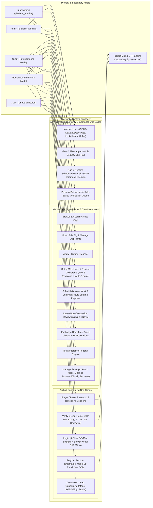
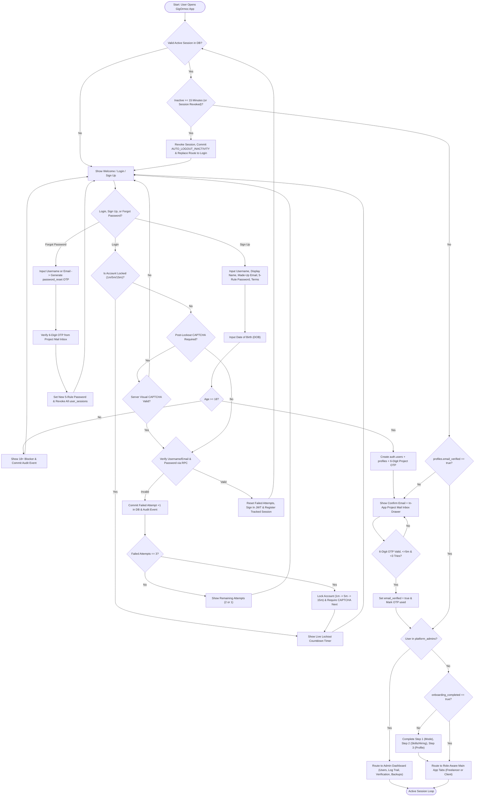
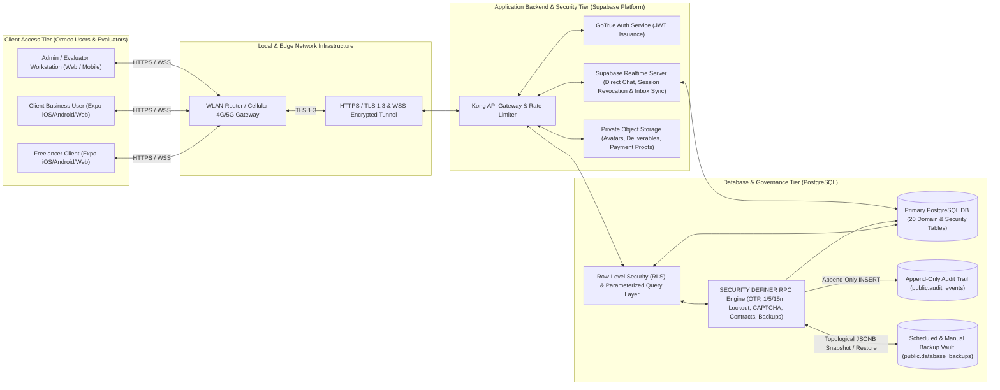

# GigOrmoc Local Freelance Marketplace & Security Architecture

*   **Author:** John Denver Lias (`denverjmliaz`)
*   **Status:** Approved
*   **Date:** 2026-11-02

--------------------------------------------------------------------------------

## Overview

GigOrmoc is a cross-platform mobile and web freelance marketplace built for Ormoc City using Expo Router (React Native + TypeScript) and Supabase (PostgreSQL, Row-Level Security, Realtime, and Storage). The application connects local freelancers (`Find Work` mode) with local clients and small businesses (`Hire Someone` mode) across 43 screens while enforcing server-side Information Assurance and Security 1 (IAS 1 Checklists A–H) and Application Development 4th Increment requirements.

The platform operates with one active role mode at a time for regular users, separates administrative governance into a dedicated Admin portal (`Admin` and `Super Admin`), tracks milestone agreements and external payments (`GCash`, `Maya`, `PayPal`, `Cash`) in integer centavos without holding funds in escrow, and provides a self-hosted 6-digit OTP verification and demo mail inbox engine that works with made-up email addresses without external SMTP dependencies.

--------------------------------------------------------------------------------

## The Problem

Local freelancers and small business clients in Ormoc City rely on informal social media posts and chat threads to find short-term work. These informal channels create four operational and security problems:

1.  **Unstructured Agreements and Payment Disputes:** Clients and freelancers lack written milestone breakdowns, revision limits, and payment receipts. Scope creep leads to uncapped unpaid revisions, and off-platform payments via GCash, Maya, or cash lack structured confirmation or dispute escalation.
2.  **Blurred Role Boundaries and Reputation Mixing:** When the same person both hires help and takes freelance gigs on general social platforms, their client history and freelancer reputation are mixed together, and nothing prevents self-dealing (applying to, hiring, or reviewing oneself).
3.  **Classroom Evaluation Failure Under External SMTP Limits:** Academic and local demonstration environments require testing dozens of account registrations, password resets, and email changes using made-up email addresses (such as `juan@gigormoc.ph` or `client1@ormoc.local`). Relying on third-party SMTP providers causes delivery failures and rate-limit blocks during live grading.
4.  **Client-Only Security Controls Bypassed at the API Layer:** Many student and prototype applications enforce login lockouts, OTP attempt counters, idle timeouts, and role checks only in React state. Refreshing the browser or calling the database API directly bypasses those checks, and throwing database exceptions rolls back security failure counters and audit logs.

GigOrmoc solves these problems by pairing a structured milestone-and-payment contract workflow with PostgreSQL `SECURITY DEFINER` RPCs that commit every security state change (`login_security_state`, `otp_challenges`, `user_sessions`, and append-only `audit_events`) inside the database while preserving native Supabase JWT authentication (`auth.users`) for Row-Level Security, Realtime chat, and file storage.

--------------------------------------------------------------------------------

## Goals

*   **Complete 43-Screen Module Coverage:** Deliver all 9 Auth & Onboarding screens and all 34 Main Application screens (Main Tabs, Gigs, Agreements, Chat & Alerts, Profile, Disputes, Settings, and Admin) defined in [AUTH_ONBOARDING_LOGIC.md](file:///c:/Users/denverjmliaz/.opencode/plan/AUTH_ONBOARDING_LOGIC.md) and [MAIN_APP_LOGIC.md](file:///c:/Users/denverjmliaz/.opencode/plan/MAIN_APP_LOGIC.md).
*   **Self-Hosted 6-Digit OTP Engine Without External SMTP (IAS 1 Part B):** Support registration, password recovery, and email change for any syntactically valid, unique email address using server-generated, bcrypt-hashed 6-digit OTPs (`5-minute` expiry, maximum `3` wrong attempts, `60-second` resend cooldown, single-use) delivered to an in-app Top Push Mail Banner and Pull-Down Project Mail Inbox Drawer.
*   **Server-Persisted Login Lockout & Self-Generated Visual CAPTCHA (IAS 1 Part D):** Enforce 3-strike consecutive failed login tracking in PostgreSQL that escalates temporary lockouts (`1 minute` -> `5 minutes` -> `15 minutes`), survives page reloads and app restarts, and requires solving a server-verified, self-generated 6-character visual alphanumeric CAPTCHA after any lockout tier is reached.
*   **Password Policy & Session Governance (IAS 1 Parts C & E):** Enforce a 5-rule live password checklist (`>= 8` characters, uppercase, lowercase, number, special character), revoke all other active sessions upon password change or reset, synchronize logout across open browser tabs and devices, block Back-button access to protected routes after logout, and auto-logout inactive sessions at `15 minutes 00 seconds` (with a 90-second countdown modal at `13 minutes 30 seconds` plus an evaluator fast-forward test trigger).
*   **Deterministic Contract, Milestone & External Payment Integrity:** Store all monetary values in integer centavos (`bigint` in PostgreSQL, safe integer `number` in TypeScript), require milestone amounts to sum to the exact contract total, cap milestone revisions at `2` with automatic escalation to `disputed` status if a client rejects work after the 2nd revision, and transition agreements to `completed` only when all milestones are `approved` and `100%` of contract centavos are marked `confirmed_received`.
*   **Role Isolation & Mode-Switch Safeguards:** Enforce a single active mode (`Find Work` or `Hire Someone`) for regular users with a server-enforced 7-day switch cooldown, active contract/payment/report blockers, and atomic cancellation of open gigs or withdrawal of pending applications on mode switch. Isolate `Admin` and `Super Admin` users (`platform_admins`) into a dedicated governance dashboard.
*   **Append-Only Audit Trail & Non-Destructive Backup/Restore (IAS 1 Parts A, F & H):** Log all security, authentication, contract, and administrative events to an append-only `public.audit_events` table (with `UPDATE` and `DELETE` revoked and zero secrets logged), and provide scheduled, manual, and pre-restore JSONB database snapshots in `public.database_backups` that admins can restore without breaking foreign keys or modifying audit history.

--------------------------------------------------------------------------------

## Non-Goals

*   **External Email Delivery:** Integrating external SMTP relays or commercial transactional email APIs (SendGrid, Resend, Mailgun).
*   **In-App Wallet or Escrow Holding:** Processing live credit cards, holding funds in escrow, or simulating wallet balances inside the application. All payments occur externally via GCash, Maya, PayPal, or Cash and are recorded as status transitions (`reported_sent`, `confirmed_received`, `disputed`).
*   **External LLM API Dependencies:** Calling paid or quota-limited external LLM APIs (OpenAI, Gemini) for skill suggestions or profile verification. Both features use deterministic local SQL and TypeScript rule engines.
*   **Simultaneous Dual-Mode Browsing:** Allowing a regular user account to post gigs as a Client and apply to gigs as a Freelancer at the same time without executing a mode switch.

--------------------------------------------------------------------------------

## Open Questions

*   None. All architectural, state-machine, and grading-rubric questions were resolved during the `/egm-brainstorm` phase and documented in [concepts_brief.md](../../concepts_brief.md).

--------------------------------------------------------------------------------

## Critical User Journeys (CUJs)

### CUJ 1: First-Time User Registration, 18+ Gate, Project OTP Verification & Onboarding

*   **Given:** An unauthenticated guest opens GigOrmoc on mobile or web.
*   **When:** The user executes the following 4-step sequence:
    1. Completes Sign Up Step 1 (`app/(auth)/signup-step1.tsx`) with a unique username, display name, unique syntactically valid email address (e.g., `marco@gigormoc.ph`), and a password satisfying all 5 complexity rules.
    2. Enters Date of Birth >= 18 years old on Sign Up Step 2 (`app/(auth)/signup-step2.tsx`).
    3. Views the 6-digit OTP inside the Top Push Mail Banner / Pull-Down Project Mail Inbox Drawer and submits it on Confirm Email (`app/(auth)/confirm-email.tsx`) within 5 minutes.
    4. Completes Onboarding Steps 1–3 (`step1-mode.tsx`, `step2-skills.tsx`, `step3-profile.tsx`).
*   **Then:** The backend creates the user in `auth.users` and `public.profiles`, verifies the hashed OTP (`email_verified = true`, `status = 'used'`), saves the selected mode (`freelancer` or `client`) and Ormoc barangay profile details (`onboarding_completed = true`), writes audit events for each transition, and routes the user to `app/(tabs)/index.tsx`.

### CUJ 2: Progressive 3-Strike Login Lockout & Self-Generated Visual CAPTCHA

*   **Given:** A registered account exists with `failed_attempts = 0` and `lockout_tier = 0` in `public.login_security_state`.
*   **When:** A user submits 2 wrong passwords on `app/(auth)/login.tsx`, then submits a 3rd wrong password, reloads the app, waits for the 1-minute Tier 1 lockout timer to expire, and attempts to log in again.
*   **Then:** Attempts 1 and 2 commit to the database and display `"2 attempts remaining"` and `"1 attempt remaining"`. Attempt 3 sets `lockout_tier = 1`, `locked_until = now() + interval '1 minute'`, and `captcha_required = true`, and logs `ACCOUNT_LOCKED_TEMP`. Reloading the page preserves the live countdown timer. Once the 1-minute lockout expires, the Login screen requires solving a server-verified 6-character Visual Alphanumeric CAPTCHA alongside the password; 3 more failures escalate the lockout to `5 minutes` (Tier 2) and then `15 minutes` (Tier 3+), whereas a valid login resets all counters to zero.

### CUJ 3: Unauthenticated Forgot Password Recovery & Session Revocation

*   **Given:** A user is logged in on Device A, and opens `app/(auth)/forgot-password.tsx` as an unauthenticated guest on Device B.
*   **When:** The user enters their username or email in Stage 1, opens the Pull-Down Project Mail Inbox Drawer to view the generated `password_reset` 6-digit OTP, verifies the OTP in Stage 2, and submits a compliant new password in Stage 3.
*   **Then:** The backend marks the OTP `verified` in Stage 2 and consumes it to `used` in Stage 3, updates `auth.users.encrypted_password`, marks every active row in `public.user_sessions` for that user as `is_revoked = true`, writes `PASSWORD_RESET_COMPLETED` and `SESSIONS_REVOKED_ON_PASSWORD_RESET` to `public.audit_events`, immediately terminates Device A's session via `SessionSyncGuard`, and redirects Device B to `app/(auth)/login.tsx`.

### CUJ 4: Milestone Agreement Execution, 2-Revision Cap & External Payment Completion

*   **Given:** A Client accepts a Freelancer's proposal on `app/gigs/[id]/applicants.tsx`, creating an active agreement (`total_amount_centavos = 500000` for PHP 5,000.00) with two milestones (`200000` and `300000` centavos).
*   **When:**
    1. *Happy Path:* The Freelancer submits work for both milestones, the Client approves both milestones (`revision_count <= 2`) and reports external GCash payments totaling `500000` centavos, and the Freelancer confirms receipt (`confirmed_received`).
    2. *Max-Revision Escalation Path:* Alternatively, on a milestone that already has `revision_count = 2`, the Client rejects the 3rd submission on `app/agreements/[id]/milestones/[milestoneId]/review.tsx`.
*   **Then:**
    1. In the Happy Path, confirming the final external payment automatically transitions `agreements.status` to `completed`, sets `completed_at = now()`, and unlocks the 14-day review window (`app/agreements/[id]/review.tsx`) for both parties.
    2. In the Max-Revision Escalation Path, rejecting the deliverable when `revision_count = 2` is blocked from requesting a 3rd revision and instead atomically transitions both the milestone and agreement to `disputed`, creates an admin moderation report in `public.reports`, and logs `AGREEMENT_AUTO_DISPUTED_MAX_REVISIONS`.

### CUJ 5: 15-Minute Inactivity Warning, Auto-Logout & Evaluator Fast-Forward

*   **Given:** An authenticated user is logged into the application with `InactivityGuard` and `SessionSyncGuard` active.
*   **When:** The user performs no touch, mouse, keyboard, or navigation activity for `13 minutes 30 seconds` (or clicks the evaluator fast-forward test button on `app/settings/sessions.tsx`), and does not click `"Stay Logged In"` before the 90-second countdown reaches `15 minutes 00 seconds`.
*   **Then:** At `13m 30s`, a modal displays a live 90-second countdown. At `15m 00s`, the app revokes the session in `public.user_sessions`, logs `AUTO_LOGOUT_INACTIVITY` in `public.audit_events`, broadcasts session termination to all open tabs, and redirects to `app/(auth)/login.tsx` with Back-button history cleared.

### CUJ 6: Admin Governance, Append-Only Audit Trail & Database Restore

*   **Given:** An authenticated `Admin` or `Super Admin` (`public.platform_admins`) opens `app/admin/dashboard.tsx`.
*   **When:** The Admin unlocks a temporarily locked user account in `app/admin/users/[id].tsx`, inspects the event in `app/admin/log-trail.tsx`, creates a manual backup in `app/admin/backups.tsx`, and restores an earlier backup snapshot after re-verifying their Admin password.
*   **Then:** Unlocking the user resets `login_security_state` and records `ADMIN_USER_UNLOCKED` in `public.audit_events`. The Security Log Trail displays the event with user, activity, timestamp, module, IP, and result, with zero edit/delete controls. Restoring the backup automatically saves a `pre_restore` snapshot first, restores the domain tables to the selected snapshot state without foreign-key errors, preserves all rows in `public.audit_events` and `public.database_backups`, and logs `DATABASE_RESTORED`.

--------------------------------------------------------------------------------

## Technical Plan (Architecture)

### 1. System Architecture & Hybrid Auth Model

GigOrmoc uses a two-layer backend model on Supabase (PostgreSQL 15+):

1.  **Identity & Transport Layer (`auth.users` + Supabase JWT):**
    *   Supabase Auth (`auth.users`) serves as the canonical password hash store (`encrypted_password` using `pgcrypto` bcrypt) and JWT issuer.
    *   External SMTP email confirmation in Supabase Auth is disabled (`email_confirm_at = now()` on creation) so that made-up email addresses (`@gigormoc.ph`, `@ormoc.local`, `@test.com`) immediately receive a valid JWT (`auth.uid()`) required by PostgreSQL Row-Level Security (RLS), Supabase Realtime channels, and Supabase Storage buckets.
    *   Application-level email verification is enforced separately via `public.profiles.email_verified` (default `false`), which blocks access to Onboarding and Main App routes and RLS write policies until a valid 6-digit OTP from `public.otp_challenges` is verified.
2.  **Transactional Security & Domain RPC Layer (`SECURITY DEFINER` PostgreSQL Functions):**
    *   All state-mutating security operations (registration, login lockout & CAPTCHA gating, OTP generation & verification, password reset & change, email change, session registration & revocation, mode switching, contract/milestone/payment transitions, and Admin user/backup management) execute inside `SECURITY DEFINER` PostgreSQL RPCs with `SET search_path = public, auth, extensions`.
    *   **Commit-on-Failure Envelope Rule:** In PostgreSQL, raising `RAISE EXCEPTION` rolls back the entire transaction—which would discard incremented `failed_attempts`, `locked_until`, `attempts_used`, and failure rows in `public.audit_events`. Therefore, every security and validation RPC commits normally and returns a structured JSONB envelope:
        ```json
        {
          "ok": false,
          "code": "INVALID_CREDENTIALS",
          "message": "Invalid username/email or password. 2 attempts remaining.",
          "remaining_attempts": 2,
          "locked_until": null,
          "lockout_tier": 0,
          "captcha_required": false
        }
        ```

#### Client-to-Supabase Authentication Handshake

1.  **Sign Up Handshake:**
    *   *Step 1 (Availability & Rules):* Client validates username uniqueness/format and password complexity rules via `rpc_check_signup_availability`.
    *   *Step 2 (Atomic Registration & 18+ Gate):* Client submits username, display name, email, password, and Date of Birth to `rpc_register_and_issue_otp`. The RPC validates `age(current_date, dob) >= interval '18 years'` first; if under 18, it records `USER_SIGNUP_REJECTED_UNDERAGE` and aborts without creating an auth user. If valid, it atomically inserts the GoTrue identity into `auth.users` and `auth.identities` (populating mandatory non-null columns: `instance_id = '00000000-0000-0000-0000-000000000000'`, `aud = 'authenticated'`, `role = 'authenticated'`, `email_confirmed_at = now()`, `encrypted_password = crypt(p_password, gen_salt('bf', 10))`, and empty strings `''` for tokens, plus `auth.identities` with `provider_id = user_id::text`), inserts `public.profiles` (`email_verified = false`), `public.login_security_state`, generates the 6-digit `signup_verification` OTP into `public.otp_challenges` and `public.project_inbox_messages`, and logs `USER_SIGNUP_COMPLETED`.
    *   *Step 3 (Client JWT & Session):* Client invokes `supabase.auth.signInWithPassword({ email, password })` to obtain the GoTrue JWT (`auth.uid()`) and calls `rpc_register_session` to register an active session row in `public.user_sessions`.
2.  **Login Handshake:**
    *   *Step 1 (Security Gating):* Client calls `rpc_verify_credentials_and_gate(identifier, password, captcha_input)`. The RPC evaluates account active/locked state, progressive 3-strike lockout (`1m -> 5m -> 15m`), single-use visual CAPTCHA verification, password verification, commits attempt counters, and resolves the username to canonical email.
    *   *Step 2 (Transport JWT):* If Step 1 returns `ok: true`, Client invokes `supabase.auth.signInWithPassword({ email: res.email, password })` to obtain the authenticated JWT.
    *   *Step 3 (Session Tracking):* Client invokes `rpc_register_session` to insert a new tracked row in `public.user_sessions` and initialize multi-tab / multi-device synchronization.

#### Database Session & Lockout Guard Predicate

To ensure that direct PostgREST or RLS queries using an existing JWT cannot bypass server-side account locks, deactivations, or the 15-minute inactivity timeout, the migrations define a `SECURITY DEFINER STABLE` SQL helper:
```sql
CREATE OR REPLACE FUNCTION public.is_authenticated_session_valid()
RETURNS boolean
LANGUAGE plpgsql
SECURITY DEFINER
STABLE
SET search_path = public, auth, extensions
AS $$
BEGIN
  RETURN EXISTS (
    SELECT 1 FROM public.profiles p
    LEFT JOIN public.login_security_state lss ON lss.user_id = p.id
    JOIN public.user_sessions us ON us.user_id = p.id
    WHERE p.id = auth.uid()
      AND p.is_active = true
      AND p.is_admin_locked = false
      AND (lss.locked_until IS NULL OR lss.locked_until <= now())
      AND us.is_revoked = false
      AND us.last_active_at >= now() - interval '15 minutes'
  );
END;
$$;
```
This predicate is enforced across all sensitive Row-Level Security policies and domain RPC operations.

```text
+-----------------------------------------------------------------------------------+
|                   CLIENT TIER (Expo Router: iOS / Android / Web)                  |
|                                                                                   |
|  +---------------------------+  +----------------------------------------------+  |
|  | Root Security Overlays    |  | Route Groups (43 Screens)                    |  |
|  | - ProjectMailInbox Drawer |  | - (auth): 6 screens     - (onboarding): 3    |  |
|  | - InactivityGuard (15m)   |  | - (tabs): 5 screens     - gigs: 4            |  |
|  | - SessionSyncGuard        |  | - agreements: 7 screens - chat/notif: 2      |  |
|  | - VisualCaptcha           |  | - profile/reports: 5    - settings: 4        |  |
|  |                           |  | - admin: 7 screens                           |  |
|  +-------------+-------------+  +----------------------+-----------------------+  |
|                |                                       |                          |
|                +-------------------+-------------------+                          |
|                                    | HTTPS (REST / RPC) + WSS (Realtime)          |
+------------------------------------+----------------------------------------------+
                                     v
+-----------------------------------------------------------------------------------+
|                        SUPABASE PLATFORM & POSTGRESQL TIER                        |
|                                                                                   |
|  +------------------------+  +-------------------------+  +--------------------+  |
|  | GoTrue Auth (JWT)      |  | Realtime Broadcast/CDC  |  | Storage Buckets    |  |
|  | auth.users / auth.uid()|  | - Direct Chat messages  |  | - avatars          |  |
|  +-----------+------------+  | - Session revocation    |  | - deliverables     |  |
|              |               | - Project Inbox banner  |  | - payment-proofs   |  |
|              v               +------------+------------+  +---------+----------+  |
|  +----------------------------------------+-------------------------+----------+  |
|  | PostgreSQL Row-Level Security (RLS) & SECURITY DEFINER RPC Engine           |  |
|  |                                                                             |  |
|  |  +--------------------------+  +-----------------------------------------+  |  |
|  |  | Security & Governance    |  | Marketplace Domain                      |  |  |
|  |  | - profiles               |  | - skills_catalog, user_skills           |  |  |
|  |  | - login_security_state   |  | - portfolio_items                       |  |  |
|  |  | - otp_challenges         |  | - gigs, applications                    |  |  |
|  |  | - project_inbox_messages |  | - agreements, milestones                |  |  |
|  |  | - user_sessions          |  | - external_payments, reviews            |  |  |
|  |  | - platform_admins        |  | - conversations, messages               |  |  |
|  |  | - audit_events (APPEND)  |  | - notifications, reports                |  |  |
|  |  | - database_backups       |  |                                         |  |  |
|  |  +--------------------------+  +-----------------------------------------+  |  |
|  +-----------------------------------------------------------------------------+  |
+-----------------------------------------------------------------------------------+
```

--------------------------------------------------------------------------------

### 2. Standardized System Integration & Architecture (SIA) Diagrams

#### 2.1 Use Case Diagram (System Actors & Use Cases)



#### 2.2 Swimlane System Flow Diagram

```mermaid
flowchart TD
    subgraph Pool_GigOrmoc["GigOrmoc End-to-End System Process Pool"]
        subgraph Lane_Guest["Lane 1: Guest / New User"]
            S1(["Start: Open GigOrmoc App"])
            S2["Submit Sign Up Step 1 (Username, Email, Password) & Step 2 (18+ DOB)"]
            S3["Open In-App Project Mail Inbox & Submit 6-Digit OTP"]
            S4["Complete Onboarding (Select Mode, Skills/Hiring Details, Area & Bio)"]
        end

        subgraph Lane_System["Lane 2: GigOrmoc Backend & Security Engine (PostgreSQL RPCs)"]
            B1{"Validate 18+ DOB, Unique Username/Email & Password Policy?"}
            B2["Create auth.users + profiles, Hash 6-Digit OTP, Dispatch Project Mail & Log Audit"]
            B3{"Verify OTP (Valid, <=5m, <3 Tries, Single-Use)?"}
            B4["Mark email_verified = true & Unlock Onboarding"]
            B5["Create Agreement, Enforce Milestone Sum == Contract Price & Log Audit"]
            B6{"All Milestones Approved AND 100% Payments Confirmed?"}
            B7["Auto-Transition Agreement to completed & Open 14-Day Review Window"]
        end

        subgraph Lane_Client["Lane 3: Client (Hire Someone Mode)"]
            C1["Post Local Gig (Budget in Centavos)"]
            C2["Review Proposals & Accept Applicant"]
            C3["Setup Milestones & Review Submitted Work (Max 2 Revisions)"]
            C4["Report External Payment (GCash/Maya/PayPal/Cash)"]
            C5["Leave Freelancer Review"]
        end

        subgraph Lane_Freelancer["Lane 4: Freelancer (Find Work Mode)"]
            F1["Browse Gigs & Submit Proposal"]
            F2["Submit Milestone Deliverable"]
            F3["Confirm External Payment Received (or Dispute)"]
            F4["Leave Client Review"]
        end

        subgraph Lane_Admin["Lane 5: Admin / Super Admin"]
            A1["Monitor Append-Only Log Trail, Lockouts, Reports, Verification & DB Backups"]
            E1(["End: Completed & Audited Lifecycle"])
        end
    end

    S1 --> S2 --> B1
    B1 -- "Invalid / Under 18" --> S2
    B1 -- "Valid" --> B2 --> S3 --> B3
    B3 -- "Invalid / Expired" --> S3
    B3 -- "Verified" --> B4 --> S4
    S4 --> C1
    S4 --> F1
    C1 --> F1 --> C2 --> B5 --> C3 --> F2 --> C3 --> C4 --> F3 --> B6
    B6 -- "No" --> C3
    B6 -- "Yes" --> B7 --> C5 & F4 --> A1 --> E1
```



#### 2.3 Entity Relationship Diagram (ERD)

> [!NOTE]
> `AUDIT_EVENTS.actor_user_id` and `DATABASE_BACKUPS.created_by_admin_id` intentionally omit foreign-key constraints to `PROFILES.id` so that non-destructive domain table restores never violate the append-only constraint on `AUDIT_EVENTS` or fail on foreign-key checks.

```mermaid
erDiagram
    PROFILES ||--o| LOGIN_SECURITY_STATE : "has security state"
    PROFILES ||--o{ OTP_CHALLENGES : "requests OTPs"
    PROFILES ||--o{ PROJECT_INBOX_MESSAGES : "receives in-app mail"
    PROFILES ||--o{ USER_SESSIONS : "maintains sessions"
    PROFILES ||--o| PLATFORM_ADMINS : "granted admin tier"
    PROFILES ||--o{ USER_SKILLS : "has freelancer skills"
    SKILLS_CATALOG ||--o{ USER_SKILLS : "categorizes"
    PROFILES ||--o{ PORTFOLIO_ITEMS : "showcases"
    PROFILES ||--o{ GIGS : "posts as client"
    GIGS ||--o{ APPLICATIONS : "receives proposals"
    PROFILES ||--o{ APPLICATIONS : "submits as freelancer"
    APPLICATIONS ||--o| AGREEMENTS : "accepted into 1 contract"
    AGREEMENTS ||--|{ MILESTONES : "divided into"
    AGREEMENTS ||--o{ EXTERNAL_PAYMENTS : "tracks payments"
    AGREEMENTS ||--o{ REVIEWS : "rated by both parties"
    APPLICATIONS ||--o| CONVERSATIONS : "initiates chat"
    CONVERSATIONS ||--o{ MESSAGES : "contains"
    PROFILES ||--o{ NOTIFICATIONS : "receives"
    PROFILES ||--o{ REPORTS : "files or targets"

    PROFILES {
        uuid id PK "Matches auth.users.id"
        text username UK "3-20 chars, lowercase/num/underscore"
        text email UK "Unique, made-up email allowed"
        text display_name
        date date_of_birth "18+ enforced, private"
        text phone "Optional, private"
        text active_mode "freelancer | client"
        timestamptz last_mode_switch_at
        boolean email_verified
        boolean onboarding_completed
        integer onboarding_step "1, 2, or 3"
        boolean is_active "Admin activate/deactivate"
        boolean is_admin_locked "Admin manual lock"
        text verification_status "unsubmitted | pending | update_requested | verified | rejected"
        integer legitimacy_score "0 to 100 rule score"
        text verification_notes
        text area_barangay
        text bio
        text avatar_url
        text client_type "individual | business"
        text business_name
        text[] hiring_interests
        numeric freelancer_rating_avg
        integer freelancer_review_count
        numeric client_rating_avg
        integer client_review_count
        timestamptz created_at
        timestamptz updated_at
    }

    LOGIN_SECURITY_STATE {
        uuid user_id PK,FK
        integer failed_attempts "0 to 3"
        integer lockout_tier "0=none, 1=1m, 2=5m, 3=15m"
        timestamptz locked_until
        boolean captcha_required
        text active_captcha_hash "Bcrypt hash of 6-char code"
        timestamptz updated_at
    }

    OTP_CHALLENGES {
        uuid id PK
        uuid user_id FK
        text target_email
        text purpose "signup_verification | password_reset | email_change"
        text otp_hash "Bcrypt hash of 6-digit OTP"
        integer attempts_used "0 to 3"
        timestamptz expires_at "created_at + 5m"
        timestamptz resend_available_at "created_at + 60s"
        timestamptz consumed_at
        text status "active | verified | used | invalidated | expired"
        timestamptz created_at
    }

    PROJECT_INBOX_MESSAGES {
        uuid id PK
        uuid user_id FK
        uuid otp_challenge_id FK
        text recipient_email
        text purpose
        text subject
        text otp_code_display "6-digit code for Demo Mail Drawer"
        timestamptz expires_at
        boolean is_read
        timestamptz created_at
    }

    USER_SESSIONS {
        uuid id PK
        uuid user_id FK
        text session_token_fingerprint
        text device_info
        text ip_address
        boolean is_revoked
        text revoked_reason
        timestamptz last_active_at "Updated on activity; 15m timeout"
        timestamptz expires_at
        timestamptz created_at
    }

    PLATFORM_ADMINS {
        uuid user_id PK,FK
        text role "admin | super_admin"
        uuid assigned_by
        timestamptz created_at
    }

    SKILLS_CATALOG {
        uuid id PK
        text name UK
        text category
        text[] keywords
    }

    USER_SKILLS {
        uuid id PK
        uuid user_id FK
        uuid skill_id FK
        text skill_name
        timestamptz created_at
    }

    PORTFOLIO_ITEMS {
        uuid id PK
        uuid user_id FK
        text title
        text description
        text media_url
        text project_link
        timestamptz created_at
    }

    GIGS {
        uuid id PK
        uuid client_id FK
        text title
        text category
        text description
        bigint budget_centavos "CHECK > 0"
        text budget_type "fixed | hourly"
        text location_barangay
        text[] required_skills
        text status "open | in_progress | completed | cancelled"
        timestamptz created_at
        timestamptz updated_at
    }

    APPLICATIONS {
        uuid id PK
        uuid gig_id FK
        uuid freelancer_id FK
        text cover_letter
        bigint proposed_rate_centavos "CHECK > 0"
        integer estimated_days "CHECK > 0"
        text status "pending | accepted | rejected | withdrawn"
        timestamptz created_at
    }

    AGREEMENTS {
        uuid id PK
        uuid gig_id FK
        uuid application_id UK,FK
        uuid client_id FK
        uuid freelancer_id FK
        bigint total_amount_centavos "CHECK > 0"
        text terms_summary
        text status "active | completed | disputed | cancelled"
        timestamptz completed_at
        timestamptz created_at
    }

    MILESTONES {
        uuid id PK
        uuid agreement_id FK
        integer sequence_order
        text title
        text description
        bigint amount_centavos "Sum == agreements.total_amount_centavos"
        integer revision_count "0 to 2 (CHECK <= 2)"
        text submission_notes
        text submission_proof_url
        text client_feedback
        text status "pending | submitted | revision_requested | approved | disputed"
        timestamptz due_date
        timestamptz created_at
    }

    EXTERNAL_PAYMENTS {
        uuid id PK
        uuid agreement_id FK
        uuid milestone_id FK
        uuid reported_by_client_id FK
        text payment_method "GCash | Maya | PayPal | Cash"
        bigint amount_centavos "CHECK > 0"
        text reference_number
        text proof_url
        text dispute_reason
        text status "reported_sent | confirmed_received | disputed"
        timestamptz confirmed_at
        timestamptz created_at
    }

    REVIEWS {
        uuid id PK
        uuid agreement_id FK
        uuid reviewer_id FK
        uuid reviewee_id FK
        text target_role "freelancer | client"
        integer rating "CHECK BETWEEN 1 AND 5"
        text comment
        timestamptz created_at
    }

    CONVERSATIONS {
        uuid id PK
        uuid gig_id FK
        uuid application_id FK
        uuid agreement_id FK
        uuid client_id FK
        uuid freelancer_id FK
        timestamptz last_message_at
        timestamptz created_at
    }

    MESSAGES {
        uuid id PK
        uuid conversation_id FK
        uuid sender_id FK
        text body
        text attachment_url
        boolean is_read
        timestamptz created_at
    }

    NOTIFICATIONS {
        uuid id PK
        uuid user_id FK
        text title
        text body
        text notification_type
        text target_route
        boolean is_read
        timestamptz created_at
    }

    REPORTS {
        uuid id PK
        uuid reporter_id FK
        uuid target_user_id FK
        uuid target_gig_id FK
        uuid target_agreement_id FK
        text category
        text description
        text evidence_url
        text status "pending | reviewed | dismissed | action_taken"
        text admin_resolution_notes
        uuid resolved_by_admin_id
        timestamptz created_at
    }

    AUDIT_EVENTS {
        uuid id PK
        uuid actor_user_id "Loose UUID (no FK)"
        text actor_identifier
        text activity
        text affected_module "AUTH | ONBOARDING | GIGS | AGREEMENTS | CHAT | PROFILE | DISPUTES | SETTINGS | ADMIN | BACKUP"
        text ip_address
        text result "SUCCESS | FAILURE | LOCKED | BLOCKED"
        jsonb metadata "Redacted: zero secrets/hashes/OTPs/tokens"
        timestamptz created_at
    }

    DATABASE_BACKUPS {
        uuid id PK
        uuid created_by_admin_id "Loose UUID (no FK)"
        text created_by_identifier
        text backup_type "scheduled | manual | pre_restore"
        text label
        text checksum_sha256
        jsonb table_row_counts
        jsonb snapshot_payload
        timestamptz created_at
    }
```



#### 2.4 System Flowchart



#### 2.5 Network Diagram (Network Flow)



--------------------------------------------------------------------------------

### 3. Security, Contract & Admin RPC Specifications

#### 3.1 Authentication, OTP, Lockout & CAPTCHA RPCs (`001_core_security_and_auth.sql`)

1.  **`rpc_check_signup_availability(p_username text, p_email text)`**:
    *   Validates username format (`^[a-z0-9_]{3,20}$`) and syntactic email format (`^[A-Za-z0-9._%+-]+@[A-Za-z0-9.-]+\.[A-Za-z]{2,}$`).
    *   Checks uniqueness against `public.profiles`.
    *   Returns `{ ok: boolean, username_available: boolean, email_available: boolean, message: text }`.
2.  **`rpc_register_and_issue_otp(p_username text, p_display_name text, p_email text, p_password text, p_dob date)`**:
    *   Enforces 18+ server-side DOB gate (`age(current_date, p_dob) >= interval '18 years'`). If under 18, logs `USER_SIGNUP_REJECTED_UNDERAGE` to `audit_events` and returns `{ ok: false, code: 'UNDERAGE_18_PLUS' }`.
    *   Atomically inserts into `auth.users` with GoTrue v2+ non-null defaults (`instance_id = '00000000-0000-0000-0000-000000000000'`, `aud = 'authenticated'`, `role = 'authenticated'`, `email_confirmed_at = now()`, `encrypted_password = crypt(p_password, gen_salt('bf', 10))`, and empty strings `''` for confirmation/recovery tokens) and `auth.identities`.
    *   Inserts `public.profiles` (`email_verified = false`, `onboarding_completed = false`, `onboarding_step = 1`) and `public.login_security_state`.
    *   Generates a 6-digit OTP, stores bcrypt hash in `public.otp_challenges` (`5m` expiry, `60s` resend cooldown, `status = 'active'`), inserts into `public.project_inbox_messages`, and logs `USER_SIGNUP_COMPLETED` and `OTP_GENERATED`.
    *   Returns `{ ok: true, user_id: uuid, email: text, challenge_id: uuid, expires_at: timestamptz }`.
3.  **`rpc_generate_otp(p_identifier text, p_purpose text, p_target_email text DEFAULT NULL)`**:
    *   Supports `signup_verification`, `password_reset`, and `email_change`.
    *   Enforces 60-second cooldown from prior challenge's `resend_available_at`.
    *   Invalidates existing active challenge, generates a fresh 6-digit OTP, stores hash, writes to `project_inbox_messages`, and logs `OTP_GENERATED`.
    *   Returns `{ ok: boolean, challenge_id: uuid, target_email: text, expires_at: timestamptz, resend_available_at: timestamptz }`.
4.  **`rpc_get_project_inbox_messages(p_recipient_email text DEFAULT NULL, p_challenge_id uuid DEFAULT NULL)`**:
    *   `SECURITY DEFINER` read helper for `<ProjectMailInbox />`.
    *   When `auth.uid() IS NOT NULL`, returns recent messages for `user_id = auth.uid()`.
    *   When `auth.uid() IS NULL` (unauthenticated signup/forgot-password), requires **both** non-null `p_challenge_id` and matching `lower(recipient_email) = lower(p_recipient_email)` for an unconsumed challenge with `expires_at > now()` and `purpose IN ('signup_verification', 'password_reset')`.
5.  **`rpc_verify_otp(p_challenge_id uuid, p_otp_code text)`**:
    *   Locks `otp_challenges` row `FOR UPDATE`. Rejects if status is not `active` or attempts used >= 3.
    *   If expired, marks `expired`, logs `OTP_FAILED`, and returns `{ ok: false, code: 'OTP_EXPIRED' }`.
    *   Verifies bcrypt hash. On failure, increments `attempts_used`; if 3, sets `status = 'invalidated'` and logs `OTP_INVALIDATED`.
    *   On match: for `signup_verification` or `email_change`, marks `status = 'used'`, sets `profiles.email_verified = true`, logs `OTP_VERIFIED`; for `password_reset`, marks `status = 'verified'` (ready to be consumed in Stage 3 password reset).
    *   Returns `{ ok: boolean, purpose: text, user_id: uuid, target_email: text }`.
6.  **`rpc_generate_captcha(p_identifier text)`**:
    *   Generates a 6-character code from `ABCDEFGHJKLMNPQRSTUVWXYZ23456789`, hashes with `crypt(upper(code), gen_salt('bf', 8))`, saves in `login_security_state.active_captcha_hash`, and returns `{ ok: true, captcha_code: text }` for `<VisualCaptcha />`.
7.  **`rpc_verify_credentials_and_gate(p_identifier text, p_password text, p_captcha_input text DEFAULT NULL)`**:
    *   Resolves username/email from `public.profiles`. Checks `is_active` and `is_admin_locked` (returns `ACCOUNT_ADMIN_LOCKED_OR_INACTIVE` on block).
    *   Checks `locked_until > now()` (returns `TEMP_LOCKED` with countdown).
    *   If `captcha_required = true`, verifies `p_captcha_input` against `active_captcha_hash`. Clears `active_captcha_hash = NULL` on evaluation to prevent replay. On failure, returns `CAPTCHA_INVALID`.
    *   Verifies password against `auth.users.encrypted_password`.
    *   On password mismatch: increments `failed_attempts`. If 3, escalates lockout tier (`1m -> 5m -> 15m`), sets `captcha_required = true`, resets `failed_attempts = 0`, logs `ACCOUNT_LOCKED_TEMP`, and returns `TEMP_LOCKED`.
    *   On password match: resets `failed_attempts = 0`, `lockout_tier = 0`, `locked_until = NULL`, `captcha_required = false`, logs `LOGIN_SUCCESS`, and returns `{ ok: true, email: text, user_id: uuid, email_verified: boolean, onboarding_completed: boolean, onboarding_step: integer }`.
8.  **`rpc_reset_password_with_otp(p_challenge_id uuid, p_otp_code text, p_new_password text)`**:
    *   Verifies challenge has `status = 'verified'` (or verifies matching `p_otp_code`), marks challenge `status = 'used'`, enforces 5 password complexity rules, updates `auth.users.encrypted_password`, revokes **all** active `public.user_sessions` for the user, resets `login_security_state`, and logs `PASSWORD_RESET_COMPLETED` and `SESSIONS_REVOKED_ON_PASSWORD_RESET`.
9.  **`rpc_change_password(p_current_password text, p_new_password text, p_current_session_id uuid)`**:
    *   Verifies `p_current_password`, ensures `p_new_password != p_current_password`, enforces 5 complexity rules, updates `auth.users.encrypted_password`, revokes all other sessions (`id != p_current_session_id`), and logs `PASSWORD_CHANGED` and `OTHER_SESSIONS_REVOKED`.
10. **`rpc_request_email_change(p_current_password text, p_new_email text)`**:
    *   Verifies password, validates email uniqueness and format, generates 6-digit `email_change` OTP to `<ProjectMailInbox />`, and returns `{ ok: true, challenge_id: uuid }`.
11. **`rpc_confirm_email_change(p_challenge_id uuid, p_otp_code text)`**:
    *   Verifies OTP, atomically updates both `auth.users.email` and `public.profiles.email`, marks OTP `used`, and logs `EMAIL_CHANGED`.
12. **`rpc_register_session(p_session_token_fingerprint text, p_device_info text, p_ip_address text)`**:
    *   Inserts a new session in `public.user_sessions` with `last_active_at = now()`, `expires_at = now() + interval '30 days'`, `is_revoked = false`, and returns `{ ok: true, session_id: uuid }`.
13. **`rpc_validate_session(p_session_id uuid)`**:
    *   Verifies session exists, is not revoked, and has `last_active_at >= now() - interval '15 minutes'`. Updates `last_active_at = now()`. Returns `{ ok: boolean, is_valid: boolean }`.
14. **`rpc_revoke_session(p_session_id uuid, p_revoke_all_others boolean DEFAULT false)`**:
    *   If `p_revoke_all_others = true`, marks `is_revoked = true` on all active sessions for `auth.uid()` where `id != p_session_id`. If `false`, marks the target session revoked. Logs `SESSION_REVOKED`.
15. **`rpc_log_inactivity_logout(p_session_id uuid)`**:
    *   Marks target session `is_revoked = true` (`revoked_reason = 'inactivity_timeout'`), logs `AUTO_LOGOUT_INACTIVITY` to `audit_events`, and returns `{ ok: true }`.

#### 3.2 Marketplace, Contract & Mode-Switch RPCs (`002_marketplace_agreements_and_admin.sql`)

1.  **`rpc_complete_onboarding_step(p_step integer, p_payload jsonb)`**:
    *   Validates payload for Onboarding Step 1 (`active_mode`), Step 2 (`skills` or `client_type` + `hiring_interests`), or Step 3 (`area_barangay`, `bio`, `avatar_url`). Updates `public.profiles` and sets `onboarding_completed = true` after Step 3.
2.  **`rpc_switch_user_mode(p_target_mode text)`**:
    *   Enforces 5 server-side blockers: (a) 7-day cooldown since `last_mode_switch_at`, (b) zero active or disputed agreements, (c) zero reported_sent or disputed payments, (d) zero pending moderation reports, and (e) account active and not admin-locked.
    *   Cancels open gigs or withdraws pending applications, updates `active_mode`, sets `last_mode_switch_at = now()`, and logs `MODE_SWITCHED`.
3.  **`rpc_create_or_update_gig(p_gig_id uuid, p_title text, p_category text, p_description text, p_budget_centavos bigint, p_budget_type text, p_location_barangay text, p_required_skills text[])`**:
    *   Verifies caller is in `client` mode. Validates `budget_centavos > 0`. Creates or updates `public.gigs`.
4.  **`rpc_submit_application(p_gig_id uuid, p_cover_letter text, p_proposed_rate_centavos bigint, p_estimated_days integer)`**:
    *   Verifies caller is in `freelancer` mode and `client_id != freelancer_id` (own-content rule). Validates `proposed_rate_centavos > 0` and `estimated_days > 0`. Inserts into `public.applications`.
5.  **`rpc_accept_application(p_application_id uuid, p_terms_summary text)`**:
    *   Verifies caller owns the gig. Transitions `applications.status = 'accepted'`, `gigs.status = 'in_progress'`, creates `public.agreements` (`total_amount_centavos = proposed_rate_centavos`, `status = 'active'`), ensures `public.conversations` row exists, notifies Freelancer, and logs `AGREEMENT_CREATED`.
6.  **`rpc_setup_milestones(p_agreement_id uuid, p_milestones jsonb)`**:
    *   Verifies caller is Agreement Client. Validates each milestone has `amount_centavos > 0` and `SUM(amount_centavos) == agreements.total_amount_centavos`. Rejects mismatches. Inserts rows into `public.milestones`.
7.  **`rpc_submit_milestone(p_milestone_id uuid, p_submission_notes text, p_submission_proof_url text)`**:
    *   Verifies caller is Agreement Freelancer. Updates `milestones.status = 'submitted'`, saves proof, notifies Client, and logs `MILESTONE_SUBMITTED`.
8.  **`rpc_review_milestone(p_milestone_id uuid, p_decision text, p_feedback text)`**:
    *   `p_decision` is `'approve'` or `'request_revision'`.
    *   If `'approve'`: sets `status = 'approved'`, checks completion via `internal_check_agreement_completion` (auto-completes agreement if all milestones approved and 100% centavos confirmed received).
    *   If `'request_revision'`: if `revision_count < 2`, increments `revision_count` and sets `status = 'revision_requested'`; if `revision_count == 2`, auto-disputes both milestone and agreement, inserts dispute into `public.reports`, and logs `AGREEMENT_AUTO_DISPUTED_MAX_REVISIONS`.
9.  **`rpc_report_external_payment(p_agreement_id uuid, p_milestone_id uuid, p_payment_method text, p_amount_centavos bigint, p_reference_number text, p_proof_url text DEFAULT NULL)`**:
    *   Verifies caller is Client. Enforces `p_amount_centavos == milestone.amount_centavos`, verifies no payment for `p_milestone_id` already has `status IN ('reported_sent', 'confirmed_received')`, and ensures agreement total payments do not exceed `agreements.total_amount_centavos`. Inserts into `public.external_payments` (`status = 'reported_sent'`), notifies Freelancer, and logs `PAYMENT_REPORTED`.
10. **`rpc_confirm_external_payment(p_payment_id uuid)`**:
    *   Verifies caller is Freelancer. Sets `status = 'confirmed_received'`, `confirmed_at = now()`, invokes `internal_check_agreement_completion`, and logs `PAYMENT_CONFIRMED`.
11. **`rpc_dispute_external_payment(p_payment_id uuid, p_reason text)`**:
    *   Verifies caller is Freelancer. Sets payment and agreement `status = 'disputed'`, creates moderation dispute in `public.reports`, and logs `PAYMENT_DISPUTED`.
12. **`rpc_submit_review(p_agreement_id uuid, p_rating integer, p_comment text)`**:
    *   Verifies agreement is `completed`, `now() <= completed_at + interval '14 days'`, rating `1..5`, and caller has not already reviewed. Inserts into `public.reviews` and updates aggregate ratings on `public.profiles`.
13. **`rpc_send_message(p_conversation_id uuid, p_body text, p_attachment_url text DEFAULT NULL)`**:
    *   Verifies caller is participant in conversation. Inserts into `public.messages`, updates `conversations.last_message_at = now()`, creates notification for recipient.
14. **`rpc_file_report(p_category text, p_description text, p_target_user_id uuid DEFAULT NULL, p_target_gig_id uuid DEFAULT NULL, p_target_agreement_id uuid DEFAULT NULL, p_evidence_url text DEFAULT NULL)`**:
    *   Enforces own-content rule (`reporter_id != target_user_id`) and `length(trim(p_description)) >= 20`. Inserts into `public.reports` (`status = 'pending'`), logs `REPORT_FILED`.
15. **`rpc_get_public_profile(p_target_user_id uuid)`**:
    *   Returns public profile projection: username, display name, avatar, bio, area barangay, ratings, review counts, user skills, portfolio items, and verification status, while strictly excluding private `date_of_birth`, `phone`, and `email`.
16. **`rpc_submit_verification_request()`**:
    *   Verifies caller is authenticated and has `verification_status IN ('unsubmitted', 'update_requested', 'rejected')`. Transitions `verification_status = 'pending'`, computes current `legitimacy_score`, and logs `VERIFICATION_SUBMITTED`.

#### 3.3 Admin Governance, Audit Trail & Backup/Restore RPCs (`001_core_security_and_auth.sql` & `002_marketplace_agreements_and_admin.sql`)

1.  **`rpc_admin_create_user(p_username text, p_display_name text, p_email text, p_password text, p_dob date, p_initial_role text DEFAULT 'client')`**:
    *   Verifies caller is in `platform_admins`. Inserts into `auth.users`, `auth.identities`, `public.profiles`, and `public.login_security_state` (plus `public.platform_admins` if `admin` or `super_admin`) without overwriting the executing Admin's JWT session.
2.  **`rpc_admin_manage_user(p_target_user_id uuid, p_action text, p_payload jsonb DEFAULT '{}')`**:
    *   Verifies caller in `platform_admins`. Supports `update_profile`, `set_active` (revokes sessions if deactivated), `set_admin_lock`, `unlock_temp_lockout` (resets failed attempts, tier, lock timer, and CAPTCHA), and `assign_role` (gated to `super_admin`). Logs `ADMIN_USER_MANAGED`.
3.  **`rpc_admin_review_verification(p_target_user_id uuid, p_decision text, p_notes text DEFAULT NULL)`**:
    *   Verifies caller in `platform_admins`. `p_decision` is `'verified'`, `'update_requested'`, or `'rejected'`. Updates `profiles.verification_status` and `verification_notes`. Logs `ADMIN_VERIFICATION_REVIEWED`.
4.  **`rpc_admin_resolve_report(p_report_id uuid, p_resolution text, p_notes text DEFAULT NULL)`**:
    *   Verifies caller in `platform_admins`. `p_resolution` is `'reviewed'`, `'dismissed'`, or `'action_taken'`. Updates `reports` status and resolution notes. Logs `ADMIN_REPORT_RESOLVED`.
5.  **`rpc_admin_ensure_scheduled_backup()`**:
    *   Idempotent helper invoked on Admin Dashboard / Backups load. Checks if a row with `backup_type = 'scheduled'` exists created within the last 24 hours; if not, calls `rpc_admin_create_backup('Daily Scheduled Backup', 'scheduled')`.
6.  **`rpc_admin_create_backup(p_label text, p_backup_type text DEFAULT 'manual')`**:
    *   Verifies caller in `platform_admins`. Serializes the canonical 17-table list into `snapshot_payload` JSONB, calculates table row counts and SHA-256 checksum, inserts into `public.database_backups`, and logs `DATABASE_BACKUP_CREATED`.
7.  **`rpc_admin_restore_backup(p_backup_id uuid, p_admin_password text)`**:
    *   Verifies caller in `platform_admins` and checks `p_admin_password` against `auth.users.encrypted_password`.
    *   **Canonical 17-Table List:** `auth.users` (minimal credential fields: `id`, `email`, `encrypted_password`, `raw_user_meta_data`, `email_confirmed_at`) + `auth.identities` -> `profiles` -> `login_security_state` -> `platform_admins` -> `skills_catalog` -> `user_skills` -> `portfolio_items` -> `gigs` -> `applications` -> `agreements` -> `milestones` -> `external_payments` -> `reviews` -> `conversations` -> `messages` -> `notifications` -> `reports`.
    *   *Step 1 (Safety Snapshot):* Automatically invokes `rpc_admin_create_backup('Auto Pre-Restore Snapshot', 'pre_restore')`.
    *   *Step 2 (Forward Topological Upsert):* Upserts snapshot rows in forward topological order across the 17 tables.
    *   *Step 3 (Reverse Topological Pruning):* Deletes rows created after the snapshot from mutable domain tables in reverse topological order, while strictly excluding the executing Admin's `user_id` and active `user_sessions` rows so the Admin is not locked out mid-restore, and preserving all rows in `public.audit_events` and `public.database_backups`.
    *   *Step 4 (Audit):* Logs `DATABASE_RESTORED` to `public.audit_events`.

--------------------------------------------------------------------------------

## Alternatives Considered

### Alternative A: 100% Custom Table-Based Auth (`public.profiles.password_hash` Without `auth.users`)

*   **Pros:** Eliminates any need to synchronize `auth.users` and `public.profiles` during registration, password resets, email changes, or Admin user creation.
*   **Cons:** Leaves `auth.uid()` null on every client request (`anon` role), which disables native PostgreSQL Row-Level Security policies, blocks authenticated Supabase Realtime channel subscriptions for direct chat and session revocation, and prevents user-scoped Supabase Storage bucket policies.
*   **Reason for Rejection:** Using Supabase Realtime, Storage, and RLS requires a valid GoTrue JWT (`auth.uid()`). Keeping `auth.users` as the canonical password and JWT authority while gating application state in `public.profiles` and `SECURITY DEFINER` RPCs preserves full RLS and Realtime functionality.

### Alternative B: External SMTP Email Delivery for OTP Verification

*   **Pros:** Delivers 6-digit verification codes to external email inboxes (Gmail, Outlook, Yahoo).
*   **Cons:** Rejects or bounces made-up classroom test emails (`@gigormoc.ph`, `@ormoc.local`), enforces strict hourly sending limits on free tiers, and introduces external network latency during live defense evaluations.
*   **Reason for Rejection:** IAS 1 and AppDev final checking require rapid testing of multiple accounts, password resets, and email changes using made-up emails. Generating bcrypt-hashed 6-digit OTPs inside PostgreSQL and delivering them via the in-app `<ProjectMailInbox />` drawer satisfies all OTP lifecycle rules (`5m` expiry, max `3` attempts, `60s` cooldown, single-use) with zero external dependencies.

### Alternative C: Throwing PostgreSQL `RAISE EXCEPTION` on Failed Login or OTP Attempts

*   **Pros:** Allows client code to catch standard SQL error codes (`P0001`) when credentials or OTPs are invalid.
*   **Cons:** In PostgreSQL, raising an exception inside a function aborts the transaction and rolls back all writes performed during that call—erasing the `failed_attempts + 1` update, the `locked_until` timestamp, the `attempts_used + 1` counter, and the failure log in `public.audit_events`.
*   **Reason for Rejection:** Security state mutations and failure audit logs must persist on every failed attempt. Returning a committed JSONB status envelope (`{ ok: false, code, message, ... }`) ensures that counters and audit logs are written to disk.

### Alternative D: Destructive Table Truncation During Database Backup Restore

*   **Pros:** Simplifies restore logic to `TRUNCATE ... CASCADE` followed by bulk `INSERT` from the JSONB snapshot.
*   **Cons:** Violates the append-only security constraint on `public.audit_events` (`REVOKE UPDATE, DELETE, TRUNCATE`), fails on foreign-key constraints between `audit_events` / `database_backups` and `profiles`, and destroys the active session of the Admin performing the restore.
*   **Reason for Rejection:** Storing `actor_user_id` and `created_by_admin_id` as loose UUIDs and executing a topological parent-first upsert followed by child-first pruning of mutable domain tables restores application state while keeping `audit_events`, `database_backups`, and the active Admin session intact.

### Alternative E: External LLM API Calls for Skill Suggestions & Profile Verification Queue

*   **Pros:** Can generate free-form text explanations for profile review or unstructured skill extraction.
*   **Cons:** Requires managing external API keys, incurs token quota limits and network failures during offline/local classroom grading, and introduces non-deterministic outputs.
*   **Reason for Rejection:** Neither feature requires an external LLM in the grading rubric. A deterministic SQL and TypeScript rule engine computes reproducible `0–100` legitimacy scores and catalog skill recommendations with zero external API keys or quota risk.

### Alternative F: Manual "Mark Agreement Completed" Button

*   **Pros:** Reduces backend state checks by letting the Client or Freelancer click a single completion button.
*   **Cons:** Allows agreements to close and reviews to be posted while milestones are still unapproved or while external payments remain unconfirmed or disputed.
*   **Reason for Rejection:** Evaluating agreement completion automatically inside `rpc_review_milestone` and `rpc_confirm_external_payment` ensures that an agreement reaches `completed` if and only if every milestone is `approved` and `confirmed_received` payments equal `100%` of `total_amount_centavos`.

--------------------------------------------------------------------------------

## Risks & Mitigations

1.  **JSONB Backup Payload Ceiling:**
    *   *Risk:* Storing database snapshots as single-row JSONB in `public.database_backups` could hit PostgreSQL row size boundaries if table row counts grow into hundreds of thousands of records.
    *   *Mitigation:* Target scale for classroom defense is `< 50,000` total domain rows (~10–20MB JSONB). Backups retain the latest 30 snapshots, exclude append-only `public.audit_events` and historical `database_backups` from nested payloads, and provide JSON export/download in `admin/backups.tsx`.
2.  **In-Database Bcrypt CPU Consumption:**
    *   *Risk:* Calling `crypt()` with high cost factors inside PostgreSQL could create CPU spikes during concurrent requests.
    *   *Mitigation:* Bcrypt cost factors are tuned for workload: `gen_salt('bf', 8)` (256 iterations) for transient 5-minute OTP and CAPTCHA hashes, and `gen_salt('bf', 10)` (1024 iterations) for user passwords. Brute-force attacks are halted by server-persisted 3-strike lockouts (`1m -> 5m -> 15m`) and 60-second OTP cooldowns.
3.  **Classroom Evaluator Demo Scope:**
    *   *Risk:* The in-app Project Mail Inbox drawer displays OTPs on the same device where the user registers or requests password resets.
    *   *Mitigation:* This behavior is explicitly designed as a simulated email client on the grading device to satisfy IAS 1 Part B without external SMTP delivery failures. For unauthenticated password resets, `rpc_get_project_inbox_messages` requires both `p_challenge_id` and matching `p_recipient_email` to prevent unauthenticated enumeration.

--------------------------------------------------------------------------------

## Non-Functional Requirements

*   **Security & Privacy (IAS 1 Checklists A–H):**
    *   **Password Hashing:** All passwords are hashed with bcrypt (`crypt(..., gen_salt('bf', 10))`). Plaintext passwords, password hashes, full OTPs, and session tokens are never written to `public.audit_events`.
    *   **PII Protection:** `date_of_birth` and `phone` are private and excluded from public profile queries (`rpc_get_public_profile`).
    *   **Append-Only Audit Trail:** `public.audit_events` revokes `UPDATE`, `DELETE`, and `TRUNCATE` from `anon`, `authenticated`, and `service_role`, enforced by an additional `BEFORE UPDATE OR DELETE` trigger that raises an unconditional error.
*   **Performance & Timer Accuracy:**
    *   All countdown timers (`5m` OTP expiry, `60s` OTP resend cooldown, `1m/5m/15m` login lockout, and `13m30s/15m00s` idle auto-logout) are computed from persisted wall-clock timestamps (`expires_at`, `resend_available_at`, `locked_until`, `last_active_at`) so backgrounded tabs or page reloads do not accumulate client-side timer drift.
*   **Rollout & Recovery:**
    *   Every execution of `rpc_admin_restore_backup` automatically creates a `pre_restore` snapshot in `public.database_backups` before mutating any domain table, allowing immediate rollback of an unintended restore.

--------------------------------------------------------------------------------

## Additional Resources

*   [AUTH_ONBOARDING_LOGIC.md](file:///c:/Users/denverjmliaz/.opencode/plan/AUTH_ONBOARDING_LOGIC.md) — Authoritative 9-screen Auth & Onboarding specification.
*   [MAIN_APP_LOGIC.md](file:///c:/Users/denverjmliaz/.opencode/plan/MAIN_APP_LOGIC.md) — Authoritative 34-screen Main Application, Settings & Admin specification.
*   [concepts_brief.md](../../concepts_brief.md) — Synthesized multi-lens brainstorm brief.

--------------------------------------------------------------------------------

## Future Improvements

*   **Receipt OCR Pre-Fill:** Optional client-side text extraction on uploaded GCash/Maya screenshot proofs to pre-fill the reference number field on `app/agreements/[id]/payments/report.tsx`.
*   **Barangay Map Filter:** Interactive Ormoc City barangay map view alongside the list filter on `app/(tabs)/gigs.tsx`.

--------------------------------------------------------------------------------

## Detailed Implementation Plan

> [!NOTE]
> File path references prefixed with `../../` indicate paths relative to `docs/designs/gigormoc_marketplace_and_security.md` (resolving to the workspace root directory `c:\Users\denverjmliaz\Documents\GigOrmocProject\GigOrmocApp`).

### Phase 1: Workspace Configuration, Database Migrations, Seed & Core Libraries (Items 1–7)

#### 1. `../../package.json`, `../../tsconfig.json`, `../../app.json`, and `../../.env.example` (Create)

*   **Type / Scope**: Expo Router Project Configuration & TypeScript Setup
*   **Proposed Changes**: Initialize the Expo SDK 52+ workspace with `expo-router`, `react-native-safe-area-context`, `react-native-screens`, `react-native-gesture-handler`, `react-native-svg` (peer dependency for `lucide-react-native`), `lucide-react-native`, `@supabase/supabase-js`, `@react-native-async-storage/async-storage`, `expo-crypto`, `expo-image-picker`, `expo-linking`, `expo-constants`, `expo-status-bar`, and web packages (`react-dom`, `react-native-web`, `@expo/metro-runtime`). Add `vitest` devDependency, TypeScript paths (`@/*`), and scripts: `"test": "vitest run"`, `"typecheck": "tsc --noEmit"`, `"lint": "expo lint"`.

#### 2. `../../supabase/migrations/001_core_security_and_auth.sql` (Create)

*   **Type / Scope**: PostgreSQL Schema, RLS Policies, Triggers & Auth/Security RPCs
*   **Proposed Changes**: Enable `pgcrypto`. Create `public.profiles`, `public.login_security_state`, `public.otp_challenges`, `public.project_inbox_messages`, `public.user_sessions`, `public.platform_admins`, `public.audit_events`, and `public.database_backups`.
    *   *Immutability Trigger:* Attach `trg_audit_events_immutable` (`BEFORE UPDATE OR DELETE`) on `public.audit_events` and revoke `UPDATE, DELETE, TRUNCATE`.
    *   *RLS Matrix:* Enable RLS across all tables. Require `is_authenticated_session_valid()` for data access. Direct `SELECT` on `profiles` restricted to `id = auth.uid()` or `platform_admins` (public profile view uses `rpc_get_public_profile`). `audit_events` and `database_backups` `SELECT` restricted to `platform_admins`.
    *   *Realtime Publications:* Add `ALTER PUBLICATION supabase_realtime ADD TABLE public.project_inbox_messages, public.user_sessions, public.profiles;`.
    *   *RPC Definitions:* Implement all 15 core security RPCs documented in Section 3.1 plus `is_authenticated_session_valid()`.

#### 3. `../../supabase/migrations/002_marketplace_agreements_and_admin.sql` (Create)

*   **Type / Scope**: PostgreSQL Marketplace Schema, RLS Policies, Contract State Machine & Admin/Backup RPCs
*   **Proposed Changes**: Create `public.skills_catalog`, `public.user_skills`, `public.portfolio_items`, `public.gigs`, `public.applications`, `public.agreements`, `public.milestones`, `public.external_payments`, `public.reviews`, `public.conversations`, `public.messages`, `public.notifications`, and `public.reports`.
    *   *Constraints:* Check constraints for positive centavos, `revision_count <= 2`, rating `1..5`, and own-content rules.
    *   *RLS Matrix:* Conversations/messages scoped to `client_id = auth.uid() OR freelancer_id = auth.uid()`. Agreements/milestones/payments scoped to agreement participants.
    *   *Realtime Publications:* Add `ALTER PUBLICATION supabase_realtime ADD TABLE public.messages, public.notifications;`.
    *   *Storage Buckets:* Create `avatars` (public read, authenticated user write own folder), `deliverables` (private, agreement participants read/write), and `payment-proofs` (private, agreement participants read/write) buckets with `storage.objects` RLS policies.
    *   *RPC Definitions:* Implement all 16 marketplace & admin RPCs documented in Sections 3.2 and 3.3.

#### 4. `../../supabase/seed.sql` (Create)

*   **Type / Scope**: Reference Catalog, Deterministic Admin Bootstrap & Baseline Snapshot
*   **Proposed Changes**:
    *   Seed `public.skills_catalog` with 24 Ormoc skills across 8 categories (Home Repair, Graphic Design, Web & IT, Event Photography, Tutoring, Bookkeeping, Delivery & Errands, Catering).
    *   Seed bootstrap accounts with GoTrue v2+ non-null defaults: `superadmin@gigormoc.ph` (username: `superadmin`, password: `SuperAdmin@123!`, role: `super_admin`) and `admin@gigormoc.ph` (username: `admin`, password: `AdminPass@123!`, role: `admin`).
    *   Seed initial baseline row in `public.database_backups` (`backup_type = 'scheduled'`, label: `'Initial Baseline Seed Backup'`).

#### 5. `../../lib/supabase.ts` (Create)

*   **Type / Scope**: TypeScript Supabase Client & Typed Generic RPC Invoker Module
*   **Proposed Changes**: Configure singleton Supabase client with platform-aware storage persistence (`AsyncStorage` on native, `localStorage` on web). Export single typed dispatcher `callRpc<T>(fnName: string, params?: Record<string, unknown>): Promise<RpcEnvelope<T>>` where `RpcEnvelope<T>` wraps `{ ok: boolean, code?: string, message?: string, data?: T }`, eliminating 30+ boilerplate pass-through wrappers. Export Realtime subscription helpers.

#### 6. `../../lib/currency.ts` (Create)

*   **Type / Scope**: Safe Integer Centavo Financial Utility Module
*   **Proposed Changes**: Standardize on JavaScript safe integer `number` centavos (accurate up to PHP 90 trillion) to prevent `JSON.stringify` `BigInt` serialization crashes in Supabase RPCs:
    *   `parsePhpToCentavos(input: string): number | null`
    *   `formatCentavosToPhp(centavos: number): string`
    *   `validateMilestoneSum(milestoneCentavos: number[], contractTotalCentavos: number): { valid: boolean; deltaCentavos: number }`

#### 7. `../../lib/verificationRules.ts` and `../../lib/ormocBarangays.ts` (Create)

*   **Type / Scope**: Deterministic Legitimacy Scoring, Skill Recommender & Ormoc Barangay Reference Data
*   **Proposed Changes**:
    *   Export complete static `ORMOC_BARANGAYS` array (58 barangays: `District 1` through `District 29`, `Airport`, `Alegria`, `Alta Vista`, `Bagong`, `Bagong Buhay`, `Bantigue`, `Batuan`, `Cabintan`, `Cabulihan`, `Can-adieng`, `Can-untog`, `Catmon`, `Cogon Combado`, `Curva`, `Danao`, `Dayhagan`, `Dolores`, `Domonar`, `Don Felipe Larrazabal`, `Doña Feliza Z. Mejia`, `Donghol`, `Esperanza`, `Hibunawon`, `Hugpa`, `Ipil`, `Lao`, `Libertad`, `Linao`, `Luna`, `Mabini`, `Macabug`, `Magaswi`, `Mahayag`, `Mahayahay`, `Margen`, `Mas-in`, `Matica-a`, `Milagro`, `Monterico`, `Nasunogan`, `Naungan`, `Nueva Sociedad`, `Patag`, `Punta`, `Quezon Jr.`, `Rufina M. Tan`, `Sabang Bao`, `Salvacion`, `San Antonio`, `San Isidro`, `San Jose`, `San Juan`, `San Pablo`, `San Vicente`, `Santo Niño`, `Sumangga`, `Tambulilid`, `Tongonan`, `Valencia`).
    *   Export `calculateLegitimacyScore(profile, metrics)` implementing 5-rule additive rubric summing to `100`: Rule 1 verified email (`20 pts`), Rule 2 avatar + bio >= 50 chars (`20 pts`), Rule 3 valid Ormoc barangay (`15 pts`), Rule 4 role completeness (`25 pts`: >= 3 skills & >= 1 portfolio for Freelancer; client type & hiring interests for Client), Rule 5 clean moderation/contract history (`20 pts`).
    *   Export `suggestSkillsFromCatalog(selectedSkills, category, queryText, catalog)` ranking by category match (`+3`) and token overlap (`+2`).

*Phase 1 Checkpoint:* Run `npm run typecheck` and `npm test` verifying that `currency.ts` and `verificationRules.ts` pass 100% of unit tests.

---

### Phase 2: Auth Context, Global Security Guards & Auth/Onboarding Screens (Items 8–16)

#### 8. `../../context/AuthContext.tsx` (Create)

*   **Type / Scope**: React Context for Authentication, Session Tracking, Route Gating & Demo Inbox State
*   **Proposed Changes**: Maintain `session`, `profile`, `adminRole`, `currentSessionId`, `activeInboxEmail`, and `activeChallengeId`. Enforce client-side route redirection matching server access rules (`Guest` -> `Confirm Email` -> `Onboarding Step 1/2/3` -> `Main Tabs` or `Admin Dashboard`) and expose actions for login, signup, logout, session refresh, and OTP inbox focus.

#### 9. `../../components/security/ProjectMailInbox.tsx` (Create)

*   **Type / Scope**: Global Self-Hosted OTP Push Banner & Pull-Down Mail Drawer Component
*   **Proposed Changes**: Poll and subscribe to `rpc_get_project_inbox_messages(activeInboxEmail, activeChallengeId)`. Render top push notification banner when a new `signup_verification`, `password_reset`, or `email_change` 6-digit OTP is generated, plus an expandable pull-down drawer showing message subject, recipient email, 6-digit code, live `mm:ss` expiration countdown (`expires_at`), and one-tap **Copy / Auto-Fill OTP** buttons.

#### 10. `../../components/security/VisualCaptcha.tsx` (Create)

*   **Type / Scope**: Self-Generated Visual Alphanumeric CAPTCHA Component
*   **Proposed Changes**: Fetch server-generated 6-character challenge via `rpc_generate_captcha(identifier)` and render each character with individual rotation angles, vertical offsets, strike-through noise lines, and a refresh button so post-lockout logins require human visual verification without external API keys.

#### 11. `../../components/security/InactivityGuard.tsx` (Create)

*   **Type / Scope**: Global 15-Minute Idle Timeout Tracker & Warning Modal (IAS 1 Part E)
*   **Proposed Changes**: Track touch, pointer, keyboard, and route-change timestamps across authenticated screens. Calculate elapsed idle time against wall-clock `Date.now()`. At `13 minutes 30 seconds` (`810s`), display modal with live 90-second countdown and **"Stay Logged In"** button. At `15 minutes 00 seconds` (`900s`), invoke `rpc_log_inactivity_logout`, revoke active session, and redirect to `/(auth)/login`. Expose `triggerEvaluatorIdleFastForward()` for live defense grading on `app/settings/sessions.tsx`.

#### 12. `../../components/security/SessionSyncGuard.tsx` (Create)

*   **Type / Scope**: Multi-Tab Logout, Session Revocation & Navigation History Guard
*   **Proposed Changes**: Listen to `supabase.auth.onAuthStateChange` paired with web `BroadcastChannel('gigormoc_auth_sync')` and Supabase Realtime subscriptions on `public.user_sessions` and `public.profiles`. When a session is revoked (via logout in another tab, password change/reset, or Admin lock/deactivation), immediately clear local auth state and call `router.replace('/(auth)/login')` so Back-button navigation cannot reopen protected screens.

#### 13. `../../components/security/PasswordChecklist.tsx`, `../../components/ui/ConfirmModal.tsx`, `../../components/ui/EmptyStateCard.tsx`, and `../../components/ui/StatusBadge.tsx` (Create)

*   **Type / Scope**: Reusable Security & Marketplace UI Primitives
*   **Proposed Changes**: Provide live 5-rule password policy checklist with Show/Hide toggles (`PasswordChecklist.tsx`), standardized confirmation dialog required before sensitive actions (`ConfirmModal.tsx`), standard empty-state placeholder rendered when queries return zero rows (without fallback mock data) (`EmptyStateCard.tsx`), and role/contract/payment status badges (`StatusBadge.tsx`).

#### 14. `../../app/_layout.tsx` and `../../app/index.tsx` (Create)

*   **Type / Scope**: Root Expo Router Layout & Initial Entry Redirector
*   **Proposed Changes**: Mount `AuthProvider`, `<ProjectMailInbox />`, `<InactivityGuard />`, and `<SessionSyncGuard />` at the root level, and route incoming users in `app/index.tsx` based on authentication, `email_verified`, `platform_admins` membership, and `onboarding_completed`.

#### 15. `../../app/(auth)/_layout.tsx`, `../../app/(auth)/welcome.tsx`, `../../app/(auth)/login.tsx`, `../../app/(auth)/signup-step1.tsx`, `../../app/(auth)/signup-step2.tsx`, `../../app/(auth)/confirm-email.tsx`, and `../../app/(auth)/forgot-password.tsx` (Create)

*   **Type / Scope**: Auth Route Group (Screens 1–6)
*   **Proposed Changes**:
    *   `_layout.tsx`: Redirect already-verified authenticated users away from guest auth screens.
    *   `welcome.tsx`: Public landing screen with entry actions for Login and Sign Up Step 1.
    *   `login.tsx`: Username-or-email + password login with Show/Hide toggle, remaining attempts alert (`2 attempts remaining`, `1 attempt remaining`), wall-clock lockout countdown timer (`01:00` / `05:00` / `15:00`), and conditional `<VisualCaptcha />` when `captcha_required = true`.
    *   `signup-step1.tsx`: Collect and validate unique username (`^[a-z0-9_]{3,20}$`), display name, unique syntactically valid email address (external SMTP deliverability not required), 5-rule password with live `<PasswordChecklist />`, confirm password, and Terms acceptance via `rpc_check_signup_availability`.
    *   `signup-step2.tsx`: Collect Date of Birth, enforce 18+ age gate, atomically create account + dispatch 6-digit `signup_verification` OTP via `rpc_register_and_issue_otp`, sign in JWT, and route to `confirm-email.tsx`.
    *   `confirm-email.tsx`: 6-digit OTP input wired to `<ProjectMailInbox />` Auto-Fill, live 5-minute expiry timer, remaining attempts counter (max 3), and 60-second resend cooldown button via `rpc_verify_otp` and `rpc_generate_otp`.
    *   `forgot-password.tsx`: 3-stage password recovery (Stage 1 Identify Account -> Stage 2 Verify 6-digit Project OTP -> Stage 3 Set New 5-Rule Password & Revoke All Sessions via `rpc_reset_password_with_otp`).

#### 16. `../../app/(onboarding)/_layout.tsx`, `../../app/(onboarding)/step1-mode.tsx`, `../../app/(onboarding)/step2-skills.tsx`, and `../../app/(onboarding)/step3-profile.tsx` (Create)

*   **Type / Scope**: Onboarding Route Group (Screens 7–9)
*   **Proposed Changes**:
    *   `_layout.tsx`: Require authenticated session with `email_verified = true`.
    *   `step1-mode.tsx`: Mandatory role selection (`Find Work` [`freelancer`] or `Hire Someone` [`client`]).
    *   `step2-skills.tsx`: Branch by selected mode—Freelancers select catalog/typed/suggested skills; Clients select `Individual` vs `Business`, optional business name, and hiring interests.
    *   `step3-profile.tsx`: Upload optional avatar, choose Ormoc City barangay from `lib/ormocBarangays.ts`, enter bio, compute initial legitimacy score, and mark `onboarding_completed = true`.

*Phase 2 Checkpoint:* Verify in browser/device: Guest -> Sign Up -> 18+ DOB -> Project Mail Banner OTP -> Confirm Email -> Onboarding Steps 1–3 -> Main App. Verify 3-strike lockout + CAPTCHA.

---

### Phase 3: Main Bottom-Tab Shell, Gigs & Milestone Agreements Lifecycle (Items 17–19)

#### 17. `../../app/(tabs)/_layout.tsx`, `../../app/(tabs)/index.tsx`, `../../app/(tabs)/gigs.tsx`, `../../app/(tabs)/activity.tsx`, `../../app/(tabs)/messages.tsx`, and `../../app/(tabs)/profile.tsx` (Create)

*   **Type / Scope**: Main Bottom-Tab Shell (Screens 10–14)
*   **Proposed Changes**:
    *   `_layout.tsx`: Enforce authenticated, verified, non-admin onboarded access and render 5 bottom tabs with unread notification/message badges.
    *   `index.tsx`: Role-aware Home Dashboard showing active agreements, pending payments/milestones, Ormoc gig recommendations (Freelancer) or applicant alerts & Post Gig CTA (Client).
    *   `gigs.tsx`: Role-aware Gigs tab—Freelancers search/filter open Ormoc gigs by category and barangay; Clients view and manage their posted gigs.
    *   `activity.tsx`: Track submitted proposals (Freelancer), active/completed agreements, and external payment statuses.
    *   `messages.tsx`: List 1-on-1 conversations with unread indicators and last message preview.
    *   `profile.tsx`: Display user profile summary, separate `freelancer_rating_avg` and `client_rating_avg` ("Reviews"), links to Profile/Settings screens, and Logout button protected by `<ConfirmModal />`.

#### 18. `../../app/gigs/post.tsx`, `../../app/gigs/[id].tsx`, `../../app/gigs/[id]/apply.tsx`, and `../../app/gigs/[id]/applicants.tsx` (Create)

*   **Type / Scope**: Gigs Lifecycle Screens (Screens 15–18)
*   **Proposed Changes**:
    *   `post.tsx`: Client-only form to create or edit a gig with title, category, description, PHP budget converted to integer centavos, Ormoc barangay, and required skills via `rpc_create_or_update_gig`.
    *   `[id].tsx`: Gig Details screen displaying budget in PHP, client reputation, barangay, and role-gated primary action (`Apply / Submit Proposal` for Freelancers; `Manage Applicants` and status controls for Client owner).
    *   `[id]/apply.tsx`: Freelancer-only proposal submission screen enforcing own-content rule (`freelancer_id != client_id`), proposed rate in centavos, estimated days, and cover letter via `rpc_submit_application`.
    *   `[id]/applicants.tsx`: Client-owner screen listing applicant proposals with links to public profiles, 1-on-1 chat, and **Accept Proposal** button (with `<ConfirmModal />`) calling `rpc_accept_application`.

#### 19. `../../app/agreements/[id].tsx`, `../../app/agreements/[id]/milestones/setup.tsx`, `../../app/agreements/[id]/milestones/[milestoneId]/submit.tsx`, `../../app/agreements/[id]/milestones/[milestoneId]/review.tsx`, `../../app/agreements/[id]/payments/report.tsx`, `../../app/agreements/[id]/payments/[paymentId]/dispute.tsx`, and `../../app/agreements/[id]/review.tsx` (Create)

*   **Type / Scope**: Agreements, Milestones, External Payments & Reviews Screens (Screens 19–25)
*   **Proposed Changes**:
    *   `[id].tsx`: Contract Hub restricted to agreement Client, Freelancer, and Admins. Displays milestone sequence, revision counters (`0/2`, `1/2`, `2/2`), external payment ledger, and contextual actions.
    *   `[id]/milestones/setup.tsx`: Client-only milestone builder validating that milestone centavos sum to `agreements.total_amount_centavos` via `validateMilestoneSum` and `rpc_setup_milestones`.
    *   `[id]/milestones/[milestoneId]/submit.tsx`: Freelancer-only screen to submit deliverable notes and proof URL via `rpc_submit_milestone`.
    *   `[id]/milestones/[milestoneId]/review.tsx`: Client-only deliverable review calling `rpc_review_milestone`. Shows remaining revisions (`2 - revision_count`); when `revision_count == 2`, warns that rejecting automatically escalates agreement to `disputed` for Admin review.
    *   `[id]/payments/report.tsx`: Client-only external payment logger (`GCash`, `Maya`, `PayPal`, `Cash`, amount in centavos, reference number, proof upload) calling `rpc_report_external_payment`.
    *   `[id]/payments/[paymentId]/dispute.tsx`: Freelancer-only payment dispute form calling `rpc_dispute_external_payment`.
    *   `[id]/review.tsx`: Post-completion mutual review screen (`1–5` stars + comment) restricted to `completed` agreements within 14 days via `rpc_submit_review`.

*Phase 3 Checkpoint:* Verify complete contract lifecycle: Client posts gig -> Freelancer applies -> Client accepts -> Client sets milestones summing to total -> Freelancer submits work -> Client reviews (test 2-revision auto-dispute) -> Client reports GCash payment -> Freelancer confirms receipt -> Agreement auto-completes -> Mutual reviews posted.

---

### Phase 4: Real-Time Chat, Notifications, Profile, Reports & Security Settings (Items 20–22)

#### 20. `../../app/chat/[conversationId].tsx` and `../../app/notifications.tsx` (Create)

*   **Type / Scope**: Real-Time Chat & System Notifications Screens (Screens 26–27)
*   **Proposed Changes**:
    *   `chat/[conversationId].tsx`: 1-on-1 real-time chat restricted to conversation participants via RLS and Supabase Realtime, with message sending via `rpc_send_message`.
    *   `notifications.tsx`: System notification center displaying contract, milestone, payment, and moderation alerts with deep-link routing and mark-as-read actions.

#### 21. `../../app/profile/edit.tsx`, `../../app/profile/skills.tsx`, `../../app/profile/portfolio.tsx`, `../../app/profile/[id].tsx`, and `../../app/reports/new.tsx` (Create)

*   **Type / Scope**: Profile Management, Public Profile & Moderation Reporting Screens (Screens 28–32)
*   **Proposed Changes**:
    *   `profile/edit.tsx`: Edit display name, Ormoc barangay, bio, avatar, client business details, and submit profile for legitimacy verification via `rpc_submit_verification_request`.
    *   `profile/skills.tsx`: Freelancer-only skill catalog manager with deterministic skill recommendations.
    *   `profile/portfolio.tsx`: Freelancer-only portfolio item CRUD.
    *   `profile/[id].tsx`: Public Profile View populated via `rpc_get_public_profile`, displaying role-specific ratings ("Reviews"), skills, and portfolio while stripping private `date_of_birth`, `phone`, and `email`.
    *   `reports/new.tsx`: Moderation report form enforcing own-content rule (`reporter_id != target_user_id`), category selection, minimum 20-character description, and evidence URL via `rpc_file_report`.

#### 22. `../../app/settings/mode.tsx`, `../../app/settings/password.tsx`, `../../app/settings/email.tsx`, and `../../app/settings/sessions.tsx` (Create)

*   **Type / Scope**: Settings & Session Security Screens (Screens 33–36 — IAS 1 Parts B, C, E)
*   **Proposed Changes**:
    *   `settings/mode.tsx`: Role switcher (`Find Work` <-> `Hire Someone`) displaying live eligibility checks for 7-day cooldown and active contract/payment/report blockers, protected by `<ConfirmModal />` and `rpc_switch_user_mode`.
    *   `settings/password.tsx`: Authenticated password change requiring current password, live 5-rule `<PasswordChecklist />`, Show/Hide toggles, and automatic revocation of all other active sessions via `rpc_change_password`.
    *   `settings/email.tsx`: Authenticated email change requiring current password + new unique email (`rpc_request_email_change`) followed by 6-digit Project OTP verification (`rpc_confirm_email_change`) before updating `profiles.email` and `auth.users.email`.
    *   `settings/sessions.tsx`: Lists tracked rows in `public.user_sessions` with device/IP/last-active metadata, individual and "Revoke All Other Sessions" buttons, plus **"Evaluator Test: Fast-Forward Idle Timer to 13m 25s"** button for live grading of 13m30s warning modal and 15m00s auto-logout.

*Phase 4 Checkpoint:* Verify direct chat in real time, notification deep-linking, public profile PII stripping, moderation report filing, 7-day mode switch cooldown & blockers, password change revoking other sessions, email change via Project Mail OTP, and evaluator idle fast-forward trigger.

---

### Phase 5: Admin Governance Portal & Automated Test Suite (Items 23–24)

#### 23. `../../app/admin/_layout.tsx`, `../../app/admin/dashboard.tsx`, `../../app/admin/users.tsx`, `../../app/admin/users/create.tsx`, `../../app/admin/users/[id].tsx`, `../../app/admin/verification.tsx`, `../../app/admin/log-trail.tsx`, and `../../app/admin/backups.tsx` (Create)

*   **Type / Scope**: Admin & Super Admin Governance Portal (Screens 37–43 — IAS 1 Parts A, F, G, H)
*   **Proposed Changes**:
    *   `admin/_layout.tsx`: Server-verified `platform_admins` guard; blocks regular users and logs `UNAUTHORIZED_ACCESS_BLOCKED` to `public.audit_events`.
    *   `admin/dashboard.tsx`: Admin Metrics Dashboard showing user counts, active lockouts, open disputes/reports, recent audit events, backup status, navigation cards, and triggers `rpc_admin_ensure_scheduled_backup()`.
    *   `admin/users.tsx`: Searchable and filterable User Directory (by username, email, display name, role, active status, lock state).
    *   `admin/users/create.tsx`: Admin User & Admin Creation form calling `rpc_admin_create_user` (validating unique username/email, 5-rule password, 18+ DOB, initial role without overwriting Admin session).
    *   `admin/users/[id].tsx`: User Detail & Moderation screen supporting profile edits, Activate/Deactivate (`is_active`), Manual Lock/Unlock (`is_admin_locked`), 1-click Reset of Temporary 3-Strike Lockout (`unlock_temp_lockout`), Role Assignment (gated to Super Admin), and Moderation Report resolution (`rpc_admin_resolve_report`), all with `<ConfirmModal />` prompts.
    *   `admin/verification.tsx`: Super Admin-only Deterministic Legitimacy Verification Queue displaying `0–100` rule breakdown with Approve, Request Update, and Reject actions via `rpc_admin_review_verification`.
    *   `admin/log-trail.tsx`: Read-only, append-only Security Log Trail viewer displaying **User**, **Activity**, **Date/Time**, **Affected Module**, **IP Address**, and **Result**, with search, module/result/date filters, and zero edit or delete controls.
    *   `admin/backups.tsx`: Database Backup & Recovery console displaying scheduled, manual, and pre-restore snapshots with SHA-256 checksums and per-table row counts, **Create Manual Backup** action (`rpc_admin_create_backup`), JSON snapshot export, and **Restore Backup** action (`rpc_admin_restore_backup`) protected by `<ConfirmModal />` + Admin password re-verification.

#### 24. `../../tests/currency.test.ts`, `../../tests/verificationRules.test.ts`, and `../../tests/security_and_marketplace_rpcs.test.ts` (Create)

*   **Type / Scope**: Automated Unit & Integration Verification Suite
*   **Proposed Changes**:
    *   `currency.test.ts`: Test `parsePhpToCentavos` (valid PHP string to centavos, commas, decimals, invalid inputs), `formatCentavosToPhp` (proper PHP currency formatting), and `validateMilestoneSum` (exact sum match, deficit, overage).
    *   `verificationRules.test.ts`: Test `calculateLegitimacyScore` (all 5 rules: email verified, bio length + avatar, Ormoc barangay validation, freelancer vs client completeness, clean moderation score summing to 100), and `suggestSkillsFromCatalog` (category relevance, keyword matching, deduplication).
    *   `security_and_marketplace_rpcs.test.ts`: Test 18+ DOB gate, 6-digit OTP 5m expiry / 3-attempt invalidation / 60s cooldown / single-use, 3-strike `1m -> 5m -> 15m` login lockout persistence + CAPTCHA gate, password reset session revocation, failed 2nd-revision auto-dispute, deterministic agreement completion, append-only `audit_events` enforcement (`UPDATE`/`DELETE` prohibited), and backup/restore preserving audit_events and database_backups.

*Phase 5 Checkpoint:* Run full test suite (`npm test`), execute Admin workflows (lockout reset, log trail review, verification decision, and non-destructive JSONB backup & restore).

---

### Verification Plan

*   **Compilation/Build**: `npx tsc --noEmit` and `npx expo export --platform web` must complete with zero TypeScript or bundler errors.
*   **Unit Tests**: `npm test` executing `tests/currency.test.ts` and `tests/verificationRules.test.ts`.
*   **Static Analysis & Linting**: `npx expo lint` verifying route exports, hook dependencies, and TypeScript strictness across all 43 screen files.
*   **Test Coverage Requirement**: 100% coverage of IAS 1 Checklists A–H security RPC gates and centavo financial helpers (`lib/currency.ts`, `lib/verificationRules.ts`, and `tests/security_and_marketplace_rpcs.test.ts`).
*   **E2E/Integration**: Execute `tests/security_and_marketplace_rpcs.test.ts` against the Supabase PostgreSQL database to verify that failed login/OTP attempts commit to disk, `UPDATE`/`DELETE` on `public.audit_events` fail with permission/trigger errors, milestone sum mismatches and 3rd revisions are rejected/escalated, and `rpc_admin_restore_backup` restores domain state while preserving `public.audit_events` and `public.database_backups`.

--------------------------------------------------------------------------------

<!-- Provenance: Indicates initial structural drafting via EGM. -->

*Drafted with EGM*
